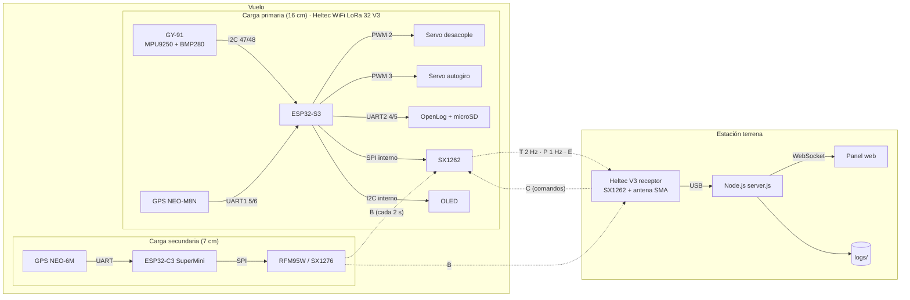

# 1. Arquitectura del sistema

## Segmentos

Las tres radios usan **la misma frecuencia (915 MHz), SF, ancho de banda y palabra de sincronía** (`RadioConfig.h`). El SX1262 y el RFM95W son chips distintos pero se entienden con esos mismos parámetros; la librería RadioLib maneja los dos (`firmware/comun/ZenitRadio`). La
estación terrena escucha a las dos cargas: si la primaria falla, igual se sabe dónde cayó la
secundaria.

## Firmware de la carga primaria

Dos núcleos del ESP32-S3 trabajando en paralelo:

| Núcleo | Tarea | Qué hace |
|---|---|---|
| 1 | `loop()` de Arduino, 50 Hz | Lee el GY-91 → orientación (Mahony + brújula) → altitud y velocidad (filtro complementario) → máquina de estados → secuencia de los 2 servos → arma tramas → pantalla (solo en tierra) |
| 0 | `comms` (FreeRTOS) | Radio y registro: envía por LoRa, escribe en el OpenLog, escucha baliza y comandos |

Así, los ~90 ms que tarda en salir una trama LoRa o una escritura lenta **nunca
retrasan** la lectura de sensores ni la decisión del desacople. Se comunican por colas.

### Cálculos

| Magnitud | Cómo | Archivo |
|---|---|---|
| Altitud | Ecuación barométrica: `h = 44330·(1 − (p/p₀)^0.1903)` con `p₀` medida en tierra al encender | `Filtros.cpp` |
| Orientación (roll, pitch, yaw) | Filtro de Mahony (giroscopio corregido con la gravedad del acelerómetro). El yaw se corrige con la brújula del MPU9250 (compensada por inclinación) | `Filtros.cpp` |
| Velocidad vertical | Filtro complementario: integra la aceleración vertical (rápida) y la corrige con la altitud del barómetro (estable) | `Filtros.cpp` |
| Altura máxima | Máximo de la altitud filtrada | `MaquinaEstados.cpp` |
| Distancia y rumbo a la secundaria | Haversine entre GPS de la primaria y GPS de la baliza | `Geo.cpp` |
| Separación a 200 m | Desacople → confirmación con el IMU (jalón ≥ 0.6 g) o reintento → autogiro 400 ms después | `Separacion.cpp` |
| Ocupación del canal LoRa | Fórmula de tiempo en el aire de Semtech (~30 % del canal) | `TiempoAire.cpp` |

### Modos de compilación

- `env:primaria` — sensores reales.
- `env:primaria_sim` — el mismo firmware, pero `Sensores.cpp` toma lecturas del
  `SimuladorVuelo` (física de la misión). Sirve para ensayar la estación terrena y el
  procedimiento del día del lanzamiento con la Heltec sola (sin sensores).
- `env:native` — pruebas de la lógica en la PC.

## Estación terrena

`server.js` recibe líneas del receptor por USB (`serialport`), las interpreta con
`src/protocolo.js`, las guarda en `logs/` y las reparte por WebSocket al panel
(`public/`). Chart.js se sirve desde `node_modules`: **el panel funciona sin internet**
(en la cancha no hay).

Fuentes de datos intercambiables: puerto serie (real), simulador (`npm run simular`) y
reproducción de una sesión guardada (`npm run replay -- logs/archivo.txt`).

## Librerías del firmware (`firmware/comun/`)

| Librería | Qué tiene | Depende de |
|---|---|---|
| `ZenitComun` | Pines, parámetros de radio, protocolo, filtros, máquina de estados, separación, GPS (Haversine, UBX), tiempo en el aire, simulador. **C++ puro**: se prueba en la PC | nada |
| `ZenitRadio` | Enlace LoRa para SX1262 (Heltec) y RFM95W (secundaria) | RadioLib |
| `ZenitSensores` | Drivers del GY-91 (MPU9250/6500/6050 + AK8963, BMP280/BME280) y configuración del GPS | Adafruit BMP280 |
| `ZenitPantalla` | OLED integrada de la Heltec | ThingPulse SSD1306 |
