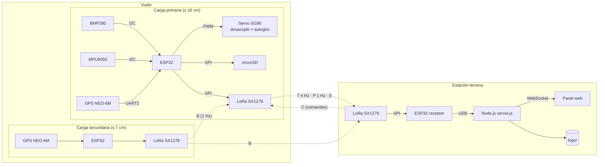

# 1. Arquitectura del sistema

## Segmentos

Las tres radios usan **la misma frecuencia y palabra de sincronía** (`RadioConfig.h`). La
estación terrena escucha a las dos cargas: si la primaria falla, igual se sabe dónde cayó la
secundaria.

## Firmware de la carga primaria

Dos núcleos del ESP32 trabajando en paralelo:

| Núcleo | Tarea | Qué hace |
|---|---|---|
| 1 | `loop()` de Arduino, 50 Hz | Lee sensores → orientación (Mahony) → altitud y velocidad (filtro complementario) → máquina de estados → servo → arma tramas |
| 0 | `comms` (FreeRTOS) | Todo lo del bus SPI: envía por LoRa, escribe la microSD, escucha baliza y comandos |

Así, los ~80 ms que tarda en salir una trama LoRa o una escritura lenta de la microSD **nunca
retrasan** la lectura de sensores ni la decisión del desacople. Se comunican por colas.

### Cálculos

| Magnitud | Cómo | Archivo |
|---|---|---|
| Altitud | Ecuación barométrica: `h = 44330·(1 − (p/p₀)^0.1903)` con `p₀` medida en tierra al encender | `Filtros.cpp` |
| Orientación (roll, pitch, yaw) | Filtro de Mahony (giroscopio corregido con la gravedad del acelerómetro). Sin magnetómetro, el yaw deriva | `Filtros.cpp` |
| Velocidad vertical | Filtro complementario: integra la aceleración vertical (rápida) y la corrige con la altitud del barómetro (estable) | `Filtros.cpp` |
| Altura máxima | Máximo de la altitud filtrada | `MaquinaEstados.cpp` |
| Distancia y rumbo a la secundaria | Haversine entre GPS de la primaria y GPS de la baliza | `Geo.cpp` |

### Modos de compilación

- `env:primaria` — sensores reales.
- `env:primaria_sim` — el mismo firmware, pero `Sensores.cpp` toma lecturas del
  `SimuladorVuelo` (física de la misión). Sirve para ensayar la estación terrena y el
  procedimiento del día del lanzamiento con un ESP32 solo.
- `env:native` — pruebas de la lógica en la PC.

## Estación terrena

`server.js` recibe líneas del receptor por USB (`serialport`), las interpreta con
`src/protocolo.js`, las guarda en `logs/` y las reparte por WebSocket al panel
(`public/`). Chart.js se sirve desde `node_modules`: **el panel funciona sin internet**
(en la cancha no hay).

Fuentes de datos intercambiables: puerto serie (real), simulador (`npm run simular`) y
reproducción de una sesión guardada (`npm run replay -- logs/archivo.txt`).
