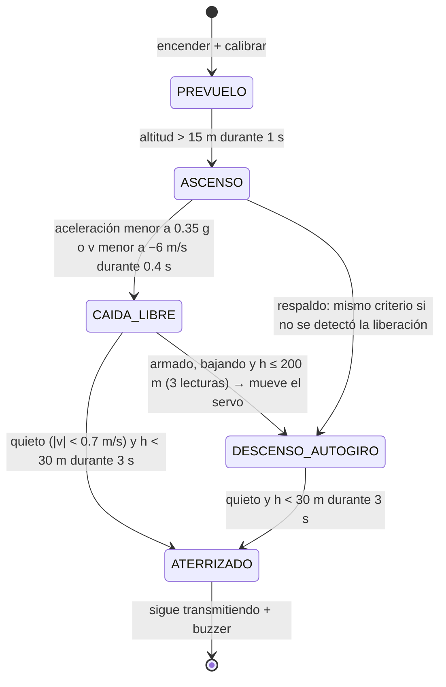

# 4. Máquina de estados de la misión

Archivo: [`firmware/comun/ZenitComun/src/MaquinaEstados.cpp`](../firmware/comun/ZenitComun/src/MaquinaEstados.cpp)

## Protecciones del desacople

El servo es un **punto único de falla** (lo dice el propio CoDR). Por eso:

1. **Armado:** no puede dispararse hasta que la altitud máxima supere **250 m**. Nunca se
   dispara en la mesa, al cargar los huevos, ni durante la subida.
2. **Confirmación:** exige 3 lecturas seguidas (60 ms) bajo 200 m y bajando a más de 3 m/s:
   un pico de ruido del barómetro no lo dispara.
3. **Respaldo automático:** si la liberación no se detectó (p. ej. el acelerómetro falló), igual
   se desacopla con la altitud.
4. **Respaldo manual:** botón *Desacople manual* en la estación terrena (pide confirmación).
5. **Una pausa del dron** a poca altura durante la subida **no** se confunde con aterrizaje
   (hay una prueba automática para esto).

## Parámetros

Todos en `mision::Parametros` (`MaquinaEstados.h`). Los de la guía (200 m) también están en
`firmware/primaria/include/config.h`.

| Parámetro | Valor | Por qué |
|---|---|---|
| alturaDesacople | 200 m | Requisito de la misión |
| alturaArmado | 250 m | Margen sobre 200 m; el dron sube a 450 m |
| alturaDeteccionAscenso | 15 m | Más que el ruido del barómetro al caminar con él |
| gCaidaLibre | 0.35 g | En caída libre el acelerómetro marca ~0 g |
| velocidadLiberacion | −6 m/s | Más rápido de lo que baja un dron |
| lecturasDesacople | 3 | Filtra picos de ruido |
| tiempoConfirmacionAterrizaje | 3 s | Evita confundir el rebote del impacto |

## Cómo probar cambios

1. `pio test -e native` en `firmware/primaria` (incluye un vuelo simulado completo).
2. Subir `env:primaria_sim` a un ESP32 y ver los eventos en la estación terrena.
