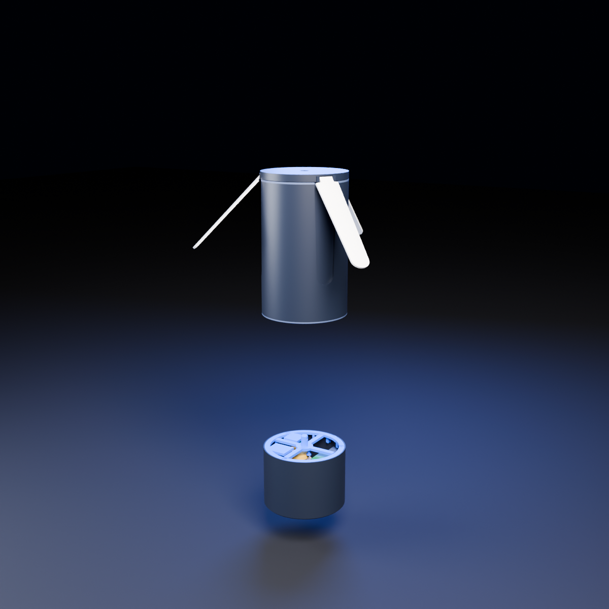
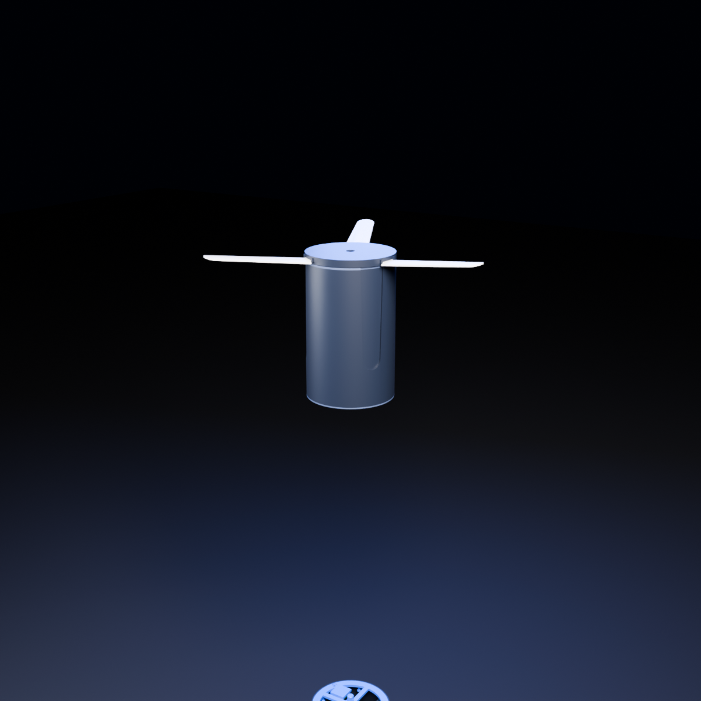
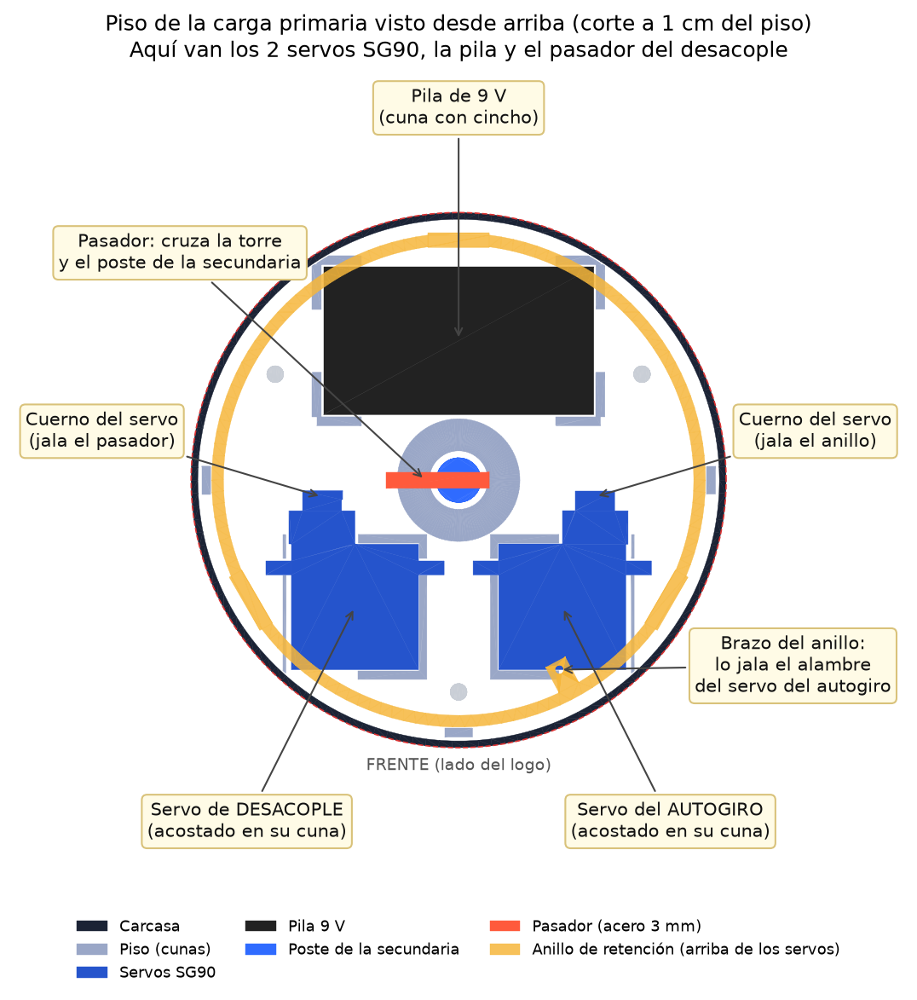
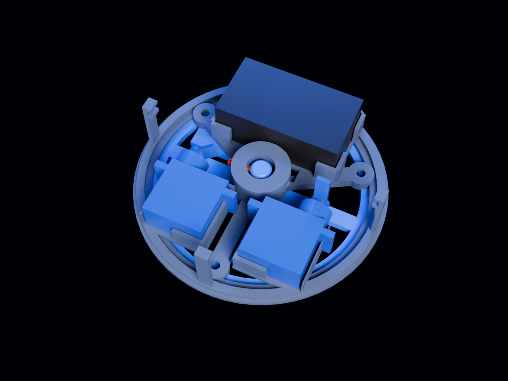
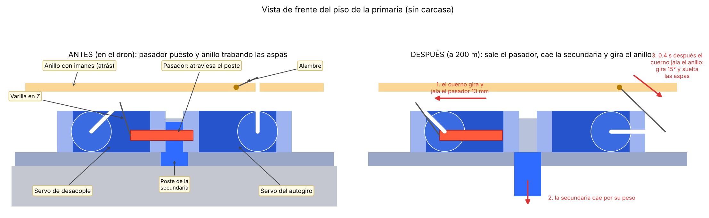
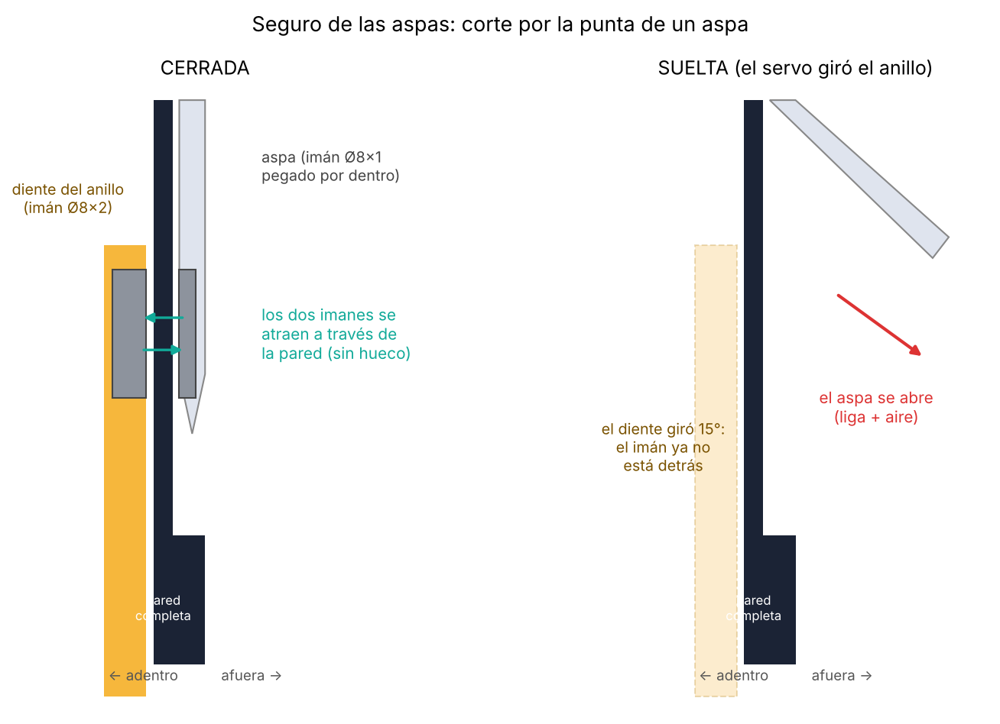

# Despliegue del autogiro y de la carga secundaria · dónde van los servos

CanSat Zénit, diseño v3 (aspas de 111 mm, de 2 mm, con bisagra de tornillo M2). Para Mecánica y Electrónica: explica paso a paso qué pasa
a 200 m, qué mueve cada servo y dónde va cada pieza. Todas las medidas salen del CAD
(`mecanica/cansat-completo/cansat_completo.py`).

## 1. La secuencia completa

| Momento | Qué pasa | Quién lo hace |
|---|---|---|
| Subida con el dron | Pasador puesto, anillo trabando las 3 aspas | Nada se mueve |
| Liberación a 450 m | Caída libre. El programa la detecta (casi 0 g) | Firmware |
| **200 m, t = 0** | El servo de desacople jala el pasador: **se suelta la secundaria** | Servo de desacople (GPIO2) |
| t ≈ 0.1 s | El IMU siente el jalón (≥ 0.6 g) y confirma la separación | GY-91 + firmware |
| **t = 0.4 s** | El servo del autogiro gira el anillo 15°: **se sueltan las 3 aspas** | Servo del autogiro (GPIO4) |
| t ≈ 0.5–1.5 s | Las ligas abren las aspas y el aire las termina de abrir; el rotor gira sobre el balero | Pasivo (sin motor) |
| Hasta el suelo | Primaria a 8–12 m/s con el autogiro; la secundaria cae libre | — |

El autogiro se suelta **siempre** 0.4 s después del desacople, aunque el IMU no confirme la
separación. Así la primaria nunca cae sin aspas.

## 2. Paso a paso

| | |
|---|---|
|  |  |
| **1. En el dron (450 → 200 m).** Cerrado, liso y de Ø 9.6 cm. Las aspas van al ras en sus canales. | **2. Desacople (200 m).** Sale el pasador y la secundaria cae por su peso. |
|  |  |
| **3. Autogiro (0.4 s después).** El anillo gira 15°, los imanes se separan y las aspas empiezan a abrirse. | **4. Descenso.** Aspas abiertas (rotor de Ø ~31 cm) girando; la pared queda completa, sin huecos. |

## 3. Dónde van los servos

- Los **2 servos SG90** van en el **piso de la carga primaria**, abajo de todo, uno junto al otro
  al frente (lado del logo). La pila de 9 V va atrás. Arriba de los servos está el disco del huevo.
- Van **acostados**: el cuerpo de 23 × 12 mm queda horizontal y la flecha mira hacia el centro
  del CanSat, del lado de afuera de cada servo.
- Cada uno entra en su **cuna impresa** (parte del piso): hueco de 23.2 × 22.9 mm, con **ranuras
  para las orejas** (32 mm de punta a punta). Se fijan con un cincho y una gota de silicón.
- Medidas usadas, de la hoja de datos del SG90: A 32, B 23, C 28.5, D 12, E 32, F 19.5 mm. Si sus
  servos miden distinto, avisen antes de imprimir el piso.
- **Cables:** salen hacia la pared y suben pegados a ella hasta la placa 1. Desacople → **GPIO2**,
  autogiro → **GPIO4**; los dos con 5 V del MP1584EN y un capacitor de 470 µF junto.

## 4. Cómo funciona el desacople

- La tapa de la secundaria tiene un **poste de Ø 8 mm** que sube y entra en la **torre central del
  piso** de la primaria.
- Un **pasador de acero de 3 mm × 18.5 mm** atraviesa la torre y el poste: mientras está puesto, la
  secundaria cuelga de él.
- El **servo de desacople** tiene un cuerno de 12 mm, inclinado 45° hacia el centro. Una **varilla de
  alambre de 1 mm doblada en Z** une la punta del cuerno con el ojo del pasador.
- A 200 m el cuerno **gira 90° hacia afuera** y jala el pasador **13 mm**: sale del poste y la
  secundaria cae por su peso. El pasador se queda guardado dentro de la torre.

## 5. Cómo se sueltan las aspas

- El **anillo de retención** va arriba de los servos y tiene **3 dientes** que suben hasta la punta
  de cada aspa. Cada diente lleva un **imán de Ø 8 × 2 mm**.
- Cada aspa lleva en su punta un **imán de Ø 8 × 1 mm**. Los dos imanes se atraen **a través de la
  pared** (1.2 mm, completa): eso detiene el aspa cerrada.
- El **servo del autogiro** tiene un cuerno de 16 mm hacia arriba, unido con **alambre** al brazo del
  anillo (agujero a 38.5 mm del centro).
- 0.4 s después del desacople el cuerno **gira 90° hacia afuera**, jala el alambre ~8.5 mm y el anillo
  **gira 15° antihorario** (visto desde arriba). Los imanes se separan y una **liga en cada bisagra** (eje: tornillo M2 × 20)
  abre el aspa; el aire termina de abrirla.
- Mientras las aspas están cerradas, el rotor no puede girar (están metidas en sus canales). Ya
  abiertas, el rotor gira libre sobre el balero 688.

## 6. Ajustes en el firmware

Con el comando `d` (desacople) y `g` (autogiro) de la guía de primera prueba se buscan los ángulos
reales y se copian a `config.h`:

| Servo | Cerrado | Abierto | Qué revisar |
|---|---|---|---|
| Desacople (GPIO2) | cuerno a 45° hacia el centro | 90° más, hacia afuera | Que el pasador salga del poste por completo |
| Autogiro (GPIO4) | cuerno hacia arriba | 90° más, hacia afuera | Que el anillo gire 15° y los imanes queden separados |

## 7. Lo que hay que probar con las piezas impresas

1. El pasador sale suave 20 de 20 veces, con la secundaria colgando (prueba P6).
2. Los imanes sostienen las aspas al sacudir el CanSat, y las sueltan al girar el anillo.
3. Las ligas abren las 3 aspas solas.
4. El servo no gira el anillo más de 17° (más se traba con el disco del huevo).
5. El CanSat armado entra en el cilindro de cartulina de 11 cm.
