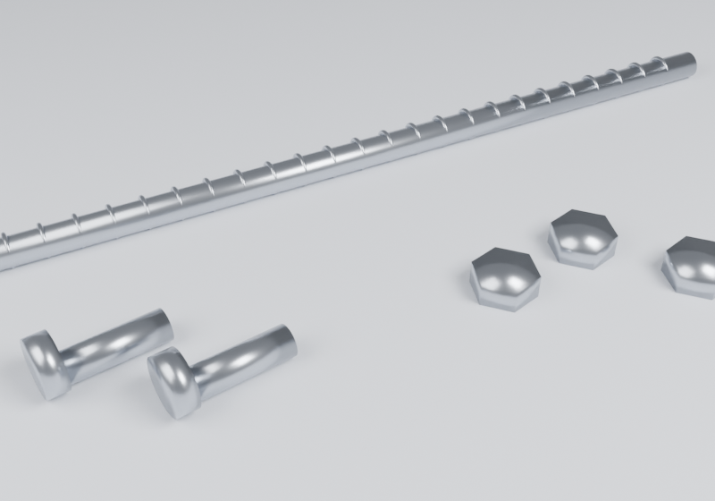
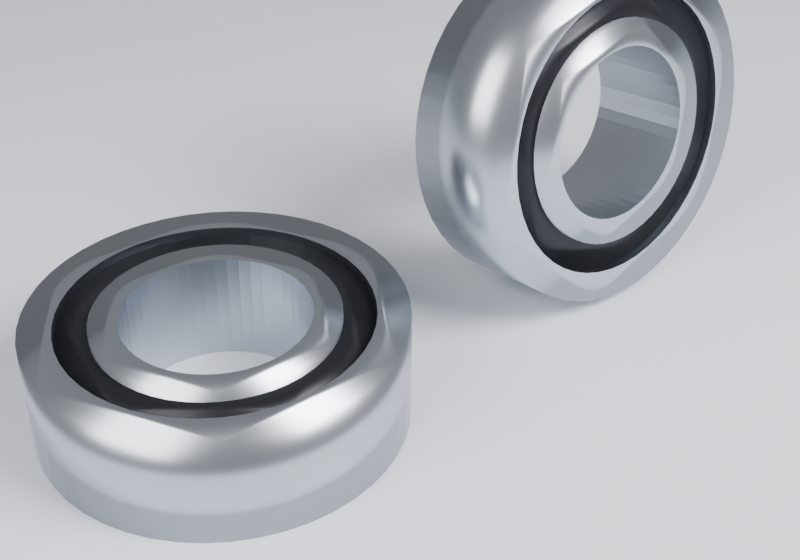
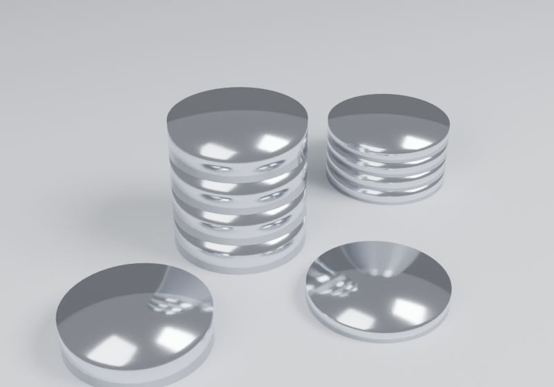
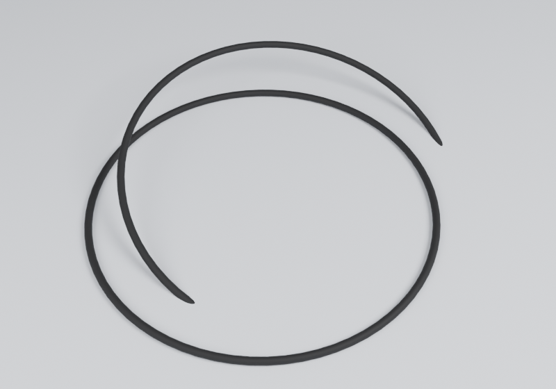
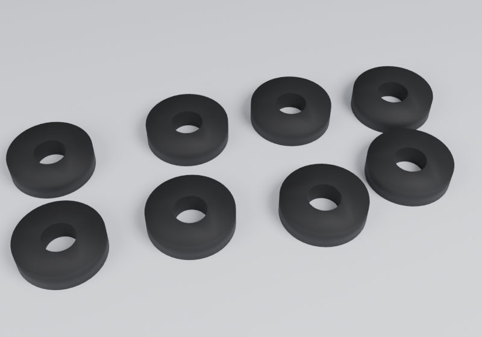
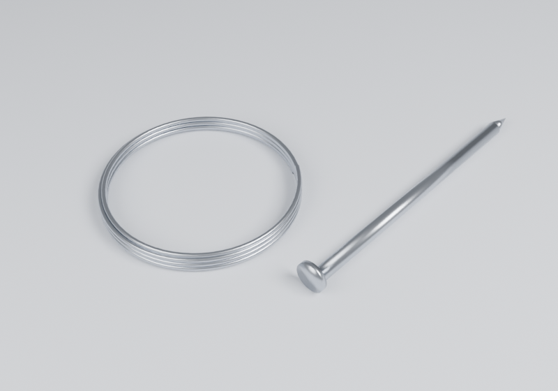
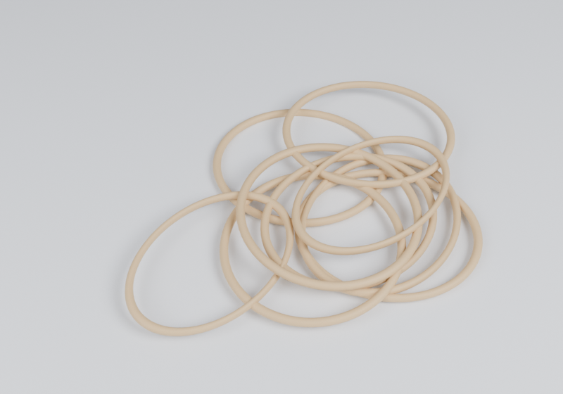
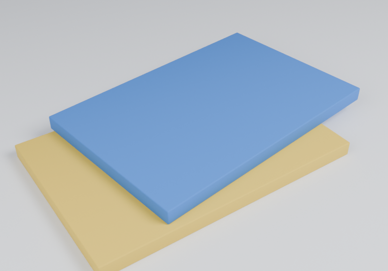
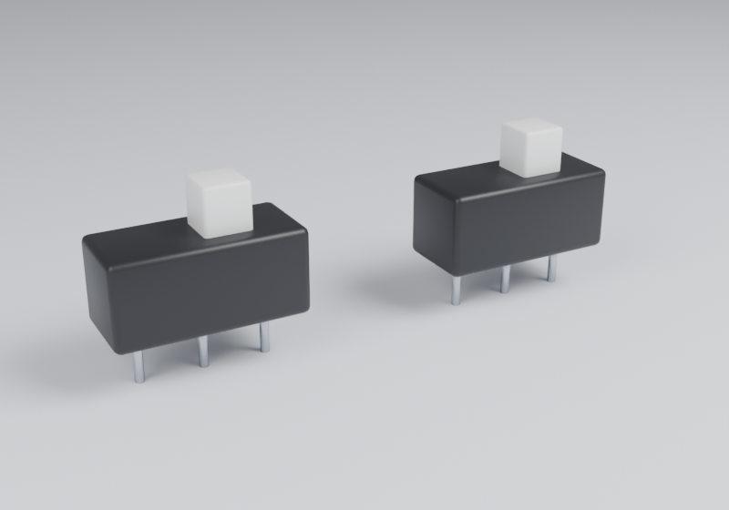
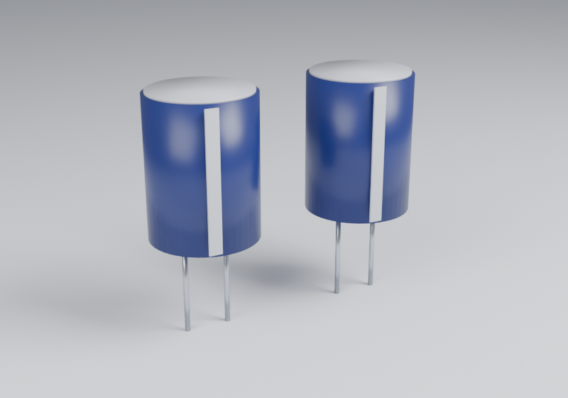

# Lo que falta comprar · e instrucciones

CanSat Zénit, diseño v2. Solo lo **extra**: no incluye la impresión 3D ni la electrónica que ya tienen.
Las imágenes son ilustrativas. Los precios son aproximados: confírmenlos en la tienda.

| ☐ | # | Qué | Cant. | Aprox. |
|---|---|---|---|---|
| ☐ | 1 | Varilla roscada M3 + tuercas y tornillos | 1 m + 20 + 6 | $60–100 |
| ☐ | 2 | Balero 688ZZ | 1 | $30–60 |
| ☐ | 3 | Imanes de neodimio Ø 8 mm | 4 de 1 mm + 4 de 2 mm | $60–120 |
| ☐ | 4 | O-ring 86 × 2 mm | 1 | $10–30 |
| ☐ | 5 | Arandelas de hule M3 | 8 | $10–30 |
| ☐ | 6 | Alambre de acero 1 mm + clavo de 3 mm | 50 cm + 1 | $20–50 |
| ☐ | 7 | Ligas chicas | 1 bolsa | $15–30 |
| ☐ | 8 | Foamy de 5 mm | 1 hoja | $20–40 |
| ☐ | 9 | Interruptor deslizable chico | 2 | $10–30 |
| ☐ | 10 | Capacitor de 470 µF | 2 | $5–20 |
| | | **Total aproximado** | | **$240–510** |

---

## 1. Varilla roscada M3, tuercas y tornillos

- **Pedir en la ferretería o tornillería:** "1 metro de varilla roscada de 3 milímetros (M3), 20 tuercas M3,
  4 tuercas M3 con seguro de nylon, 6 tornillos M3 de 10 mm y 1 tornillo M3 de 12 mm con rondana".
- **Para qué:** las 3 varillas son la columna que carga todo el peso cuando el dron levanta el CanSat.
- **Cómo:** cortar 3 pedazos de **14.8 cm** (148 mm) con segueta y limar las puntas para que entre la tuerca. Van del piso
  a la tapa de la electrónica, con una tuerca abajo (en el hexágono del piso) y otra arriba.
  **No las dejen más largas:** si sobresalen de la tapa, chocan con el rotor y las aspas no giran.
- **No cambia el tamaño:** van por dentro del cilindro, y su peso (unos 21 g las 3) ya está contado en los 587 g.

## 2. Balero 688ZZ

- **Pedir en una tienda de baleros, de refacciones de patines o en Mercado Libre:** "balero 688ZZ"
  (8 mm por dentro, 16 mm por fuera, 5 mm de grueso). El ZZ significa que trae tapas metálicas.
- **Para qué:** el rotor de las aspas gira sobre él.
- **Cómo:** se mete a presión en la torre de la tapa de la electrónica. El perno del rotor entra en el centro
  y se detiene por abajo con el tornillo M3 de 12 mm y la rondana. Debe girar suave.

## 3. Imanes de neodimio Ø 8 mm

- **Pedir en Mercado Libre o en una tienda de electrónica:** "imanes de neodimio redondos de 8 × 1 mm" y
  "de 8 × 2 mm" (N45 o N52). Compren 1 extra de cada uno.
- **Para qué:** sostienen las 3 aspas cerradas a través de la pared, sin agujeros.
- **Cómo:**
  1. Los de **2 mm** van en los 3 dientes del anillo de retención; los de **1 mm**, en la punta de cada aspa, por dentro.
  2. **Antes de pegar**, junten cada par: el de 2 mm y el de 1 mm se deben **atraer**. Marquen con plumón la cara
     que va hacia afuera.
  3. Pegar con una gota de Kola Loca y dejar secar 24 h.
- Cuidado: son muy fuertes y se rompen si chocan entre sí. Guárdenlos lejos de tarjetas y celulares.

## 4. O-ring de 86 × 2 mm

- **Pedir en una tienda de empaques o sellos (o en Mercado Libre):** "o-ring de 86 mm de diámetro
  interior por 2 mm de grueso". Si no hay de 86, sirve uno de 85.
- **Para qué:** centra el módulo de electrónica dentro del tubo y amortigua golpes de lado.
- **Cómo:** se pone en la ranura del disco base de la electrónica. Al meter el módulo en el tubo, roza los
  3 canales de las aspas: es normal.

## 5. Arandelas de hule M3

- **Pedir en la ferretería:** "8 arandelas de hule para tornillo de 3 mm" (de unos 8 mm por fuera y 2 mm de
  grueso). También sirven de silicón.
- **Para qué:** amortiguan las 3 placas en el aterrizaje.
- **Cómo:** 4 van abajo de la placa 1 (una en cada torre del disco) y 4 arriba de la placa 3. Apretar las
  tuercas sin aplastar el hule.

## 6. Alambre de acero de 1 mm y clavo de 3 mm

- **Pedir en la ferretería o en una tienda de aeromodelismo:** "50 cm de alambre cuerda de piano de 1 mm" y
  "un clavo o varilla de acero de 3 mm" (sin cabeza o se la cortan).
- **Para qué:**
  - El **clavo de 3 mm** es el **pasador** del desacople: sostiene la secundaria.
  - El **alambre** une cada servo con lo que mueve.
- **Cómo:**
  1. Cortar el clavo a **18.5 mm**, limar las puntas y hacer una muesca con lima cerca de un extremo.
  2. Con pinzas, doblar un pedazo de alambre en forma de **Z** (unos 10 mm): un extremo al agujero del cuerno
     del servo de desacople y el otro enrollado en la muesca del pasador.
  3. Otro pedazo de alambre une el cuerno del servo del autogiro con el brazo del anillo.
  4. Del mismo alambre (o uno de 1.5 mm) se cortan los 3 ejes de las bisagras de las aspas (18 mm cada uno).

## 7. Ligas chicas

- **Pedir en la papelería:** "una bolsa de ligas del número 10" (chicas, de unos 3 cm).
- **Para qué:**
  - **Hamaca de los huevos:** cada huevo va colgado con ligas entre los ganchitos de abajo y de arriba.
    En el golpe las ligas se estiran y el huevo no pega contra el plástico.
  - **Resorte de las aspas:** una liga en cada bisagra empuja el aspa hacia afuera cuando se suelta.
- **Cómo:** cruzar 3 o 4 ligas entre los ganchos, formando una red, y acostar el huevo en medio. Cambien
  las ligas antes del lanzamiento: con el tiempo se aflojan.

## 8. Foamy de 5 mm

- **Pedir en la papelería:** "una hoja de foamy de 5 mm" (goma EVA gruesa). Cualquier color.
- **Para qué:** la cama y el techo de cada huevo, para que no se mueva.
- **Cómo:** cortar 2 círculos por huevo (uno abajo y uno arriba) del tamaño del disco donde va.

## 9. Interruptor deslizable chico

- **Pedir en una tienda de electrónica:** "interruptor deslizable miniatura de 3 patas" (tipo SS12D00).
- **Para qué:** la guía pide un interruptor para prender y apagar el CanSat sin abrirlo. Va uno en cada carga.
- **Cómo:** se conecta en el cable **positivo (rojo)** de la pila, antes del regulador. **Todavía falta definir
  dónde va**, para que no sobresalga de la pared; avísenme cuando lo tengan y lo agrego al diseño.

## 10. Capacitor electrolítico de 470 µF

- **Pedir en una tienda de electrónica:** "2 capacitores electrolíticos de 470 microfaradios, de 10 V o más".
- **Para qué:** cuando un servo arranca jala mucha corriente y puede reiniciar la Heltec. El capacitor da ese
  golpe de corriente.
- **Cómo:** uno junto a cada servo, entre **5 V y GND**. **Tiene polaridad:** la pata del lado de la franja
  blanca (−) va a GND. Si se conecta al revés, se puede dañar.

---

## Pilas: cuáles usar

| Para qué | Qué pila | Por qué |
|---|---|---|
| **Pruebas** (banco, techo, caídas) | 9 V **alcalina** normal (Duracell o Energizer), o **recargable** de 9 V si harán muchas pruebas | Son más baratas. El peso extra no importa en las pruebas |
| **Día del lanzamiento** | 9 V **de litio nuevas** (Energizer Ultimate Lithium), 2 | Pesan 12 g menos cada una. Con alcalinas el CanSat pasaría de 600 g |

La guía solo acepta pilas **cuadradas de 9 V**, de cualquier tipo. Las de litio cómprenlas al final, solo
para el lanzamiento.
