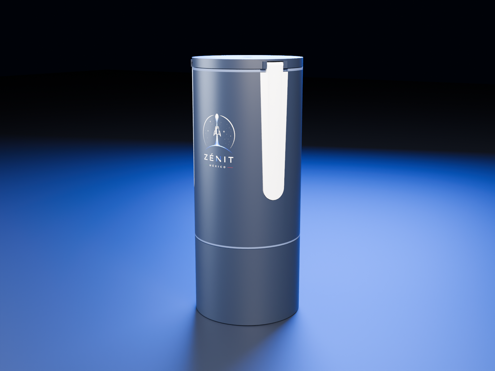
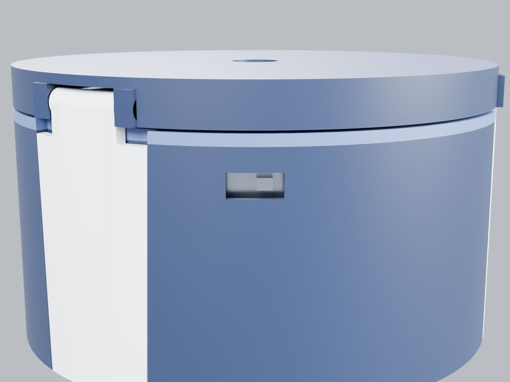
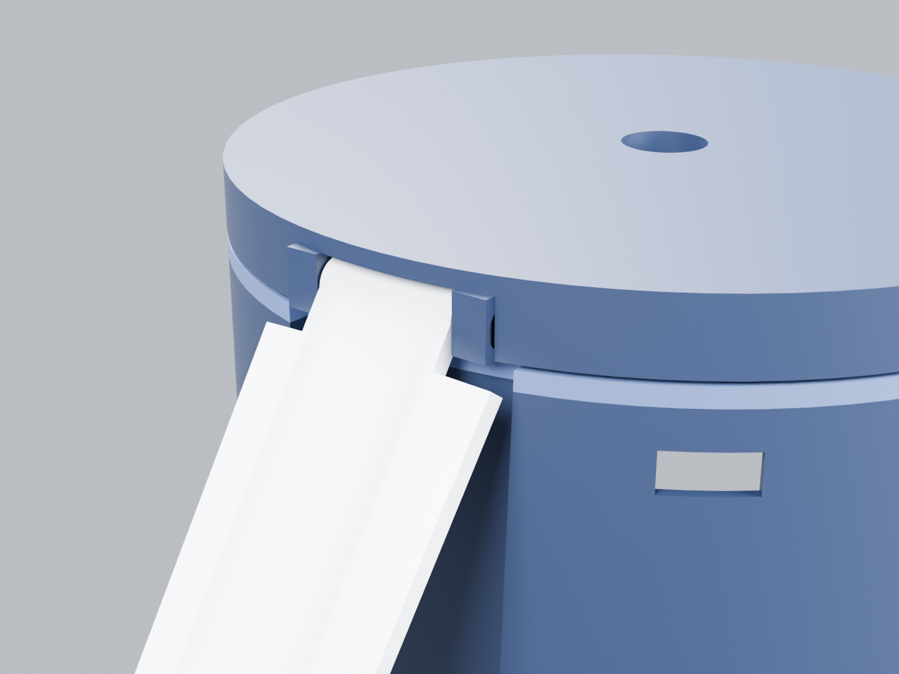
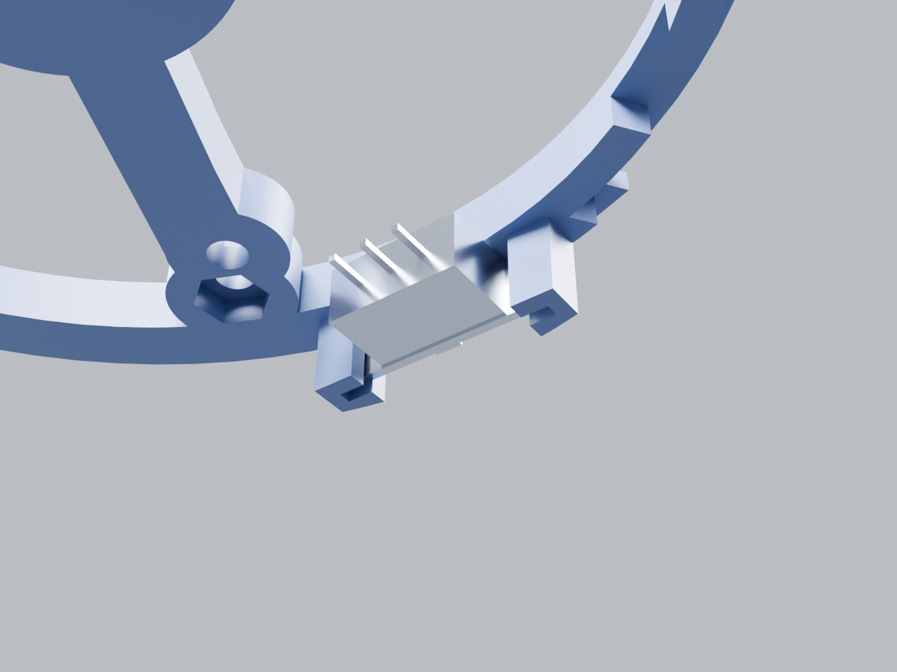

# CanSat Zénit · diseño v3 · información para revisión

Equipo Zénit, CanSat 2026 (PEU-UM). Este documento acompaña los archivos del modelo para que el
profesor pueda revisarlo y proponer cambios. **Todas las medidas están en milímetros.**

## 1. Archivos que se entregan

| Archivo | Qué es | Cómo abrirlo en AutoCAD |
|---|---|---|
| `ensamble_cansat.step` | Todo el CanSat armado, en **sólidos** (con los componentes comprados de muestra) | Dibujo nuevo en milímetros → comando **IMPORT** → elegir el .step |
| `piezas_step/*.step` | Cada pieza impresa por separado, en sólidos (16 archivos) | Igual: **IMPORT** |
| `Zenit_CanSat_ensamble_3D.dxf` | Ensamble 3D en mallas, una capa por pieza | **Open** → tipo DXF |
| `Zenit_CanSat_plano_cotas.dxf` | Plano 2D con las medidas generales | **Open** → tipo DXF |

**Para tener el .dwg:** abrir el .dxf (o importar el .step) y **Save As → AutoCAD 2018 Drawing (*.dwg)**.
Para modificar piezas conviene el .step, porque son sólidos que se pueden editar. El .dxf 3D es solo
superficie.

**Ejes del modelo:** Z hacia arriba. **Z = 0 es el fondo de la carga secundaria**; la unión de las dos
cargas está en Z = 70. Las aspas están a 90°, 210° y 330° (medidos desde +X, antihorario visto desde
arriba) y las 3 varillas de la columna a 30°, 150° y 270°, en un radio de 38.

## 2. Lo que pide la guía (no se puede cambiar)

| Requisito | Límite | Diseño |
|---|---|---|
| Diámetro | 90 a 100 | 96 |
| Alto total | 200 a 230 | 229 |
| Carga primaria / secundaria | ≤ 160 / ≤ 70 | 159 / 70 |
| Peso con 2 huevos de 65 g y pilas | ≤ 600 g | **~595 g** (quedan ~5 g) |
| Superficie lisa, sin protuberancias | autogiro "embebido" | aspas al ras, en canales |
| Orificio del dron en la tapa | Ø 9–10, ≥ 3 de hondo | Ø 9.5 × 3.5 |
| Hoyos en la pared | solo el del dron | + 2 ventanas de interruptor (autorizadas) |
| Debe entrar en el cilindro de revisión | Ø 110 | Ø 96 |

## 3. Medidas principales

| Parte | Medida |
|---|---|
| Pared de las carcasas | 1.2 (radio exterior 48, interior 46.8) |
| Canal de cada aspa (por fuera de la pared) | 2.4 de hondo; fondo en radio 45.6 |
| Aspa | 111 de largo, 26 de ancho en la raíz y 20 en la punta, **2.0 de grueso**, curva (radio 48) |
| Bisagra | eje en radio 45.3 y Z = 224; nudillo Ø 5; lengüeta de 15 |
| Orejas del rotor | 3.6 de grueso; eje = **tornillo M2 × 20** (avellanado Ø 4.2 × 1.5 en una oreja, rosca en la otra) |
| Rotor | plato de 1.8, falda de 1.2, gira sobre un balero 688ZZ |
| Tapa de la electrónica | de Z = 215.8 a 220.8, con ceja de Ø 96 sobre el borde del tubo (Z = 218.8) |
| Interruptor, primaria | ventana de 9 × 4.2 a 126°, centro en Z = 212.7 |
| Interruptor, secundaria | ventana de 9 × 4.2 a 69°, centro en Z = 63.9 |
| Columna | 3 varillas roscadas M3 de 148, del piso a la tapa de la electrónica |

## 4. Qué cambió en la versión 3

1. **Bisagra más fuerte.** El eje era un alambre de 1.5 mm y las orejas tenían 2.5 de grueso (quedaban
   0.7 mm de plástico alrededor del hoyo). Ahora el eje es un tornillo M2 × 20, las orejas tienen 3.6 y
   el nudillo del aspa tiene Ø 5. El eje se movió 1 mm hacia arriba y 1.1 mm hacia adentro para que
   todo el tornillo quede dentro del rotor.
2. **Aspas de 2.0 mm** (antes 1.6) y en PLA: casi el doble de rígidas. Los canales pasaron de 2.0 a 2.4
   de hondo.
3. **Interruptor de encendido** en cada carga: un interruptor deslizable con orejas (placa de 19.6 × 5.8)
   entra por abajo en una cunita de 2 ranuras que cuelga de la tapa. La palanca se corta a 2.3 sobre
   la placa y queda 0.5 adentro de la pared. Una pestaña en la tapa hace que solo cierre en la posición
   correcta.

Se revisó que no haya choques entre piezas armadas y que cada aspa abra de 0° a 96° sin tocar el rotor,
la tapa ni la carcasa.

## 5. Lo que nos gustaría que revisara

- **Gruesos:** si le parece que alguna pieza sigue muy delgada (aspas, orejas, plato del rotor, pared) y
  de cuánto la haría.
- **Tornillos:** si prefiere otra medida o tornillo con tuerca en las bisagras.
- **Peso:** solo quedan ~5 g. Como referencia: +0.1 mm en las 3 aspas ≈ +0.9 g; +0.4 mm en la pared de
  las carcasas ≈ +37 g. Con varillas de aluminio en lugar de acero se recuperan ~11 g.
- **Aspas más gruesas** hacen el canal más hondo y quitan espacio por dentro (el o-ring de la electrónica
  centra contra los canales).

