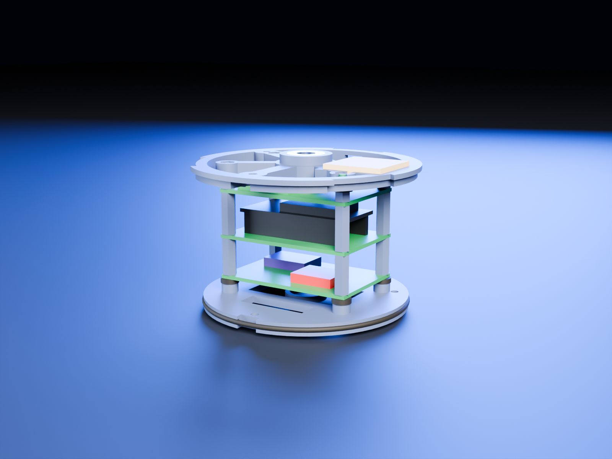
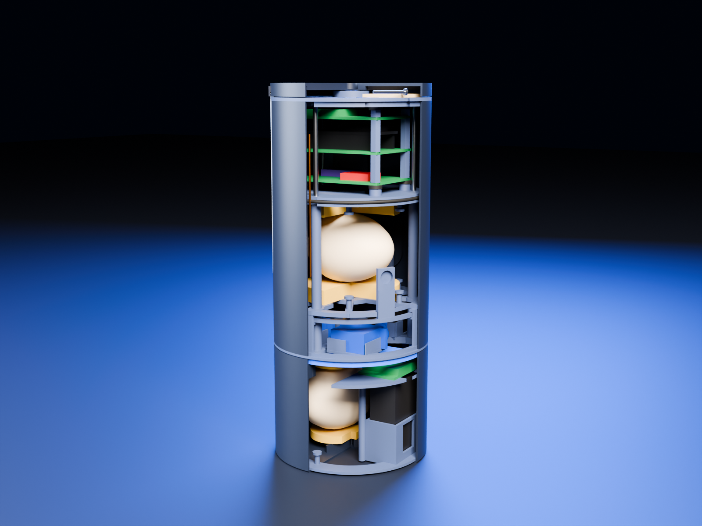
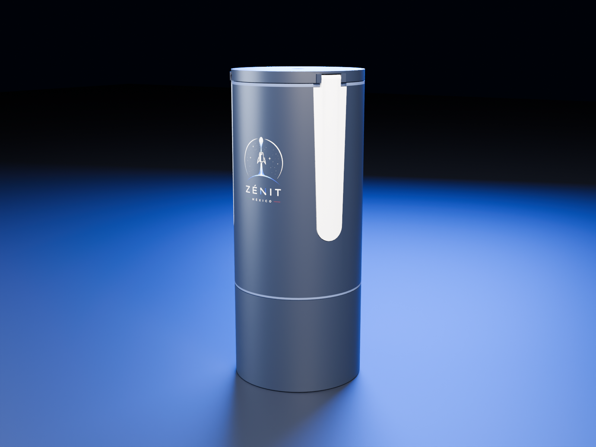

# Protección de la electrónica · carga primaria

Para el equipo de Electrónica. Explica qué protege a las 3 placas de 4 × 6 cm (con la Heltec V3,
el GY-91, el OpenLog y el GPS NEO-M8N), qué se agregó al diseño y qué hay que hacer al armarlas.
Va con el diseño completo del CanSat (`mecanica/cansat-completo`).

## 1. Dónde van

Las 3 placas van una sobre otra, en la parte de arriba de la carga primaria, entre dos discos impresos:

| Altura (desde la base del módulo) | Qué hay |
|---|---|
| Disco base (5 mm) | Tiene el o-ring en el canto y 4 torres para la placa 1 |
| Arandela de hule (2 mm) | Una en cada torre |
| Placa 1 | GY-91 y OpenLog (y reguladores si van aquí) |
| 16 mm | Separadores |
| Placa 2 | Heltec WiFi LoRa 32 V3 con su pantalla |
| 18 mm | Separadores (la Heltec mide ~14 mm de alto) |
| Placa 3 | GPS NEO-M8N |
| 4 mm + arandela de hule (2 mm) | Separador corto y hule arriba |
| Tapa | Antena GPS de 25 mm (mirando al cielo) y el balero del autogiro |

Todo el módulo mide ~61 mm de alto y entra en el tubo, que mide Ø 93.6 mm por dentro.

## 2. Qué las protege

| Golpe o riesgo | Qué lo absorbe |
|---|---|
| Golpe de lado | La carcasa: las placas no tocan la pared. El **o-ring** del disco base se apoya en los 3 canales de las aspas: frena y centra el módulo |
| Golpe de arriba a abajo (aterrizaje) | **Sándwich de hule:** 4 arandelas abajo de la placa 1 y 4 arriba de la placa 3 |
| Vibración y rebotes | El mismo hule; las placas no quedan sueltas |
| Que algo se mueva | Cada placa va con 4 tornillos M3; nada cuelga |

**¿Por qué hule firme y no ligas?** El GY-91 (el IMU) va en estas placas. Colgado de ligas, el
bloque se balancearía: mediría mal la orientación y podría no detectar el jalón del desacople
(el programa espera un cambio de 0.6 g). El hule corto absorbe el golpe sin dejar que se
balancee. Es lo mismo que usan los drones con su controladora de vuelo.

Con el autogiro, la primaria aterriza a 8–12 m/s. Las placas aguantan ese golpe; lo que suele
fallar es lo de la sección 4.

## 3. Cómo se arma el sándwich de hule

1. Comprar **8 arandelas de hule o silicón** de Ø 8 mm, agujero de 3 mm y 2 mm de grueso (o
   cortarlas de una tira de hule de 2 mm con un sacabocados).
2. Poner una arandela en cada torre del disco base y encima la placa 1.
3. Armar hacia arriba con los separadores de 16 y 18 mm (placa 2 y placa 3).
4. Encima de la placa 3 van los separadores cortos de 4 mm, luego una arandela de hule en cada
   uno y luego la tapa.
5. Apretar las 4 tuercas **parejo y sin aplastar** el hule: solo hasta que dejen de girar con la
   mano y un cuarto de vuelta más. Usar tuercas con seguro (de nylon) o una gota de fijador de
   rosca, para que no se aflojen con la vibración.

## 4. Lista para Electrónica: lo que de verdad se rompe

- [ ] **Conectores** (servos, pila, JST): una gota de silicón o pegamento caliente para que no se zafen.
- [ ] **Conector IPEX** de la antena LoRa y de la antena GPS: es el más frágil. Ponerle una gota de
      silicón encima y fijar el cable con cinta para que no jale el conector.
- [ ] **Cables soldados gruesos** (pila, 5 V): termofit en cada soldadura.
- [ ] **Cables con holgura**: que ninguno vaya tenso. Cinchos cada 3–4 cm.
- [ ] **Pantalla OLED** de la Heltec: una gota de silicón en cada esquina (el vidrio se puede despegar).
- [ ] **GY-91**: bien soldado o atornillado, plano y firme. Que no quede colgando de sus pines.
- [ ] **Pila de 9 V**: va en la cuna del piso con un cincho; no debe poder moverse.
- [ ] Al terminar, correr el **autodiagnóstico P1** y después sacudir el CanSat cerrado (prueba P8):
      todo debe seguir en PASA.

## 5. Cómo se verá: colores y logo

Las imágenes son el modelo real en CAD. Para que la pieza impresa se vea igual:

| Pieza | Color de filamento |
|---|---|
| Carcasas, rotor y tapas | PLA o PETG gris grafito o azul marino mate |
| Aspas | PLA blanco (se ven como 3 franjas blancas con el CanSat cerrado) |
| Tapa de la secundaria | Azul (opcional, como acento) |
| Piezas internas | Cualquier color (no se ven) |

**El logo es una calcomanía**, no sale de la impresora:

- Mandar a imprimir el logo en **vinil** (imprenta o rotulación), de unos **4.5 × 6 cm**, con
  laminado mate para que no se raye.
- Pegarlo al frente de la carga primaria, **entre dos aspas**, nunca encima de la ranura de un
  aspa porque se rompería al abrirse.
- El vinil mide ~0.1 mm, así que la superficie sigue lisa como pide la guía.
- Imprimir el logo en relieve con la impresora 3D no se recomienda: deja un escalón en la pared.

## 6. Material que se compra para esto

| Cantidad | Pieza |
|---|---|
| 8 | Arandelas de hule o silicón Ø 8 × 3 × 2 mm |
| 1 | O-ring 85 × 2 mm |
| 4 | Tuercas M3 con seguro de nylon |
| — | Silicón, termofit, cinchos chicos y cinta |
| 1 | Calcomanía de vinil del logo (4.5 × 6 cm) |
