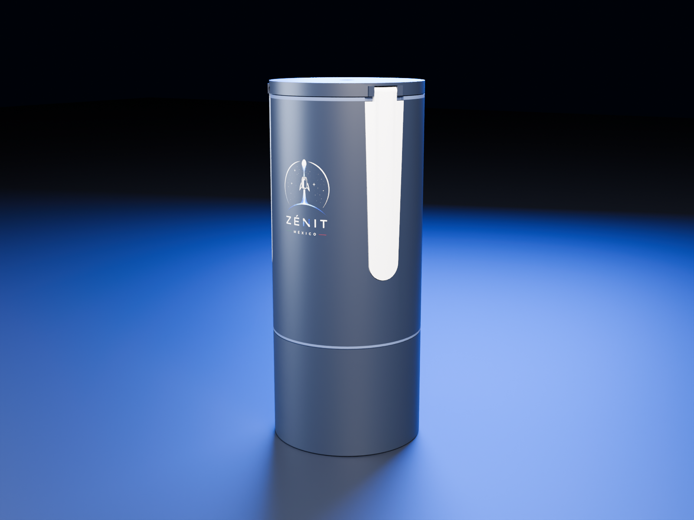
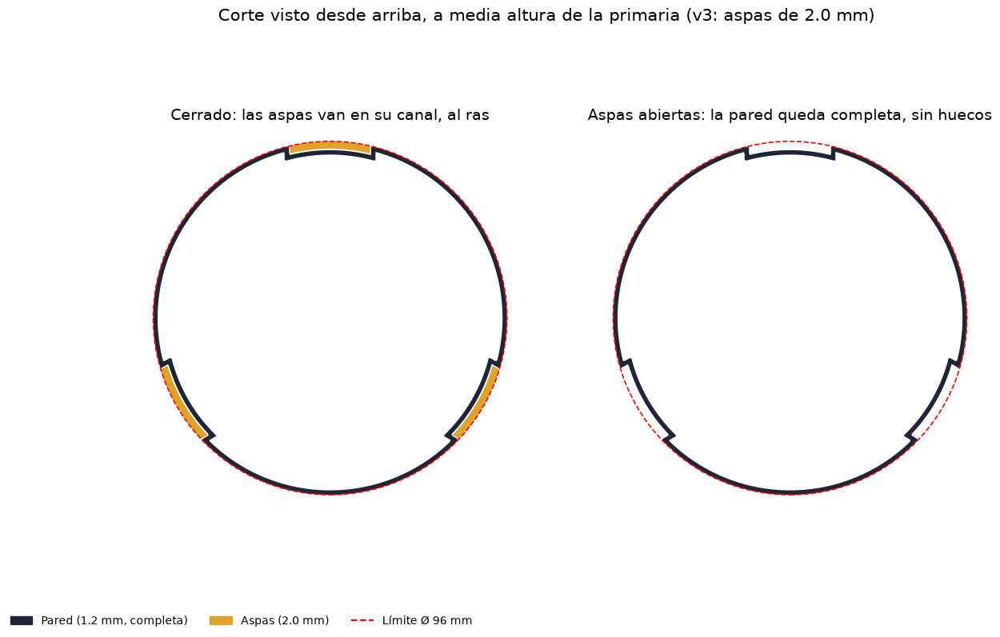
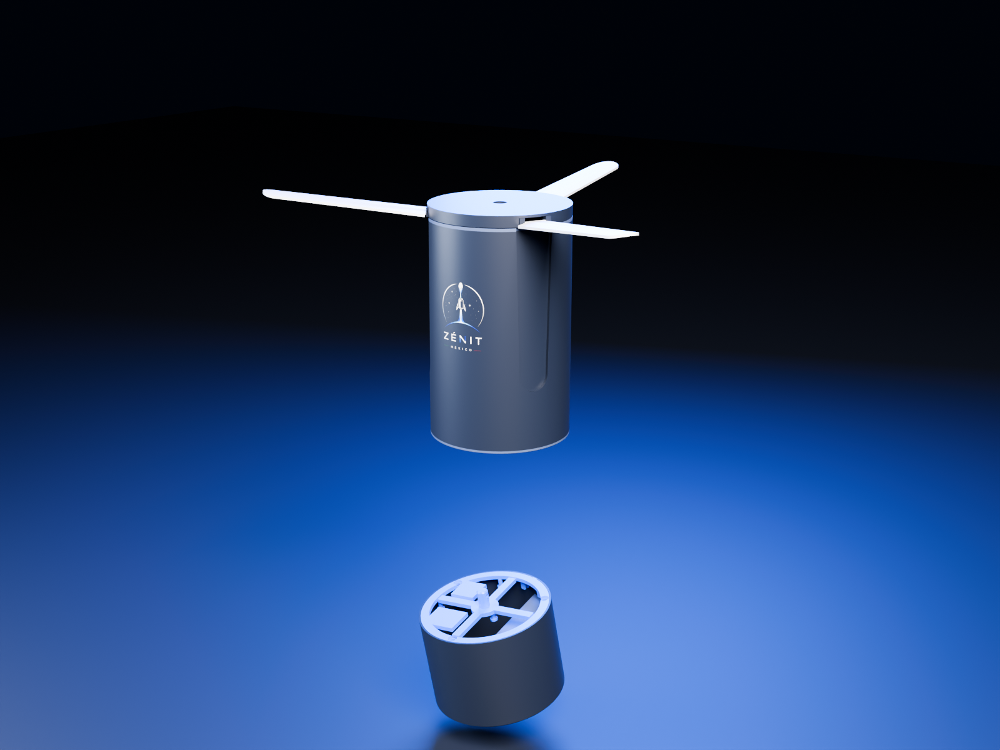
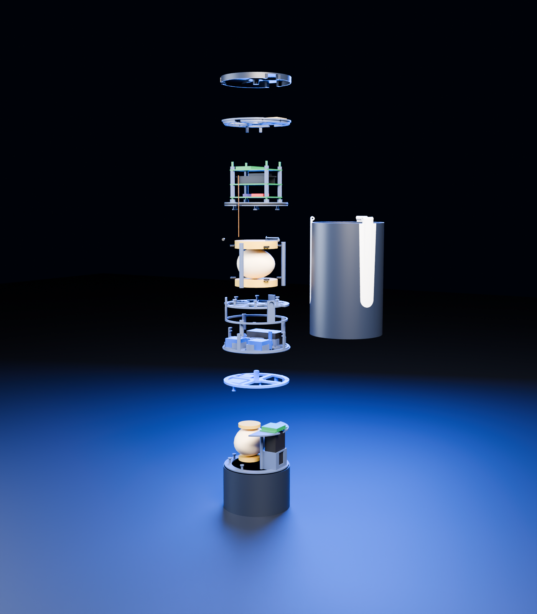

# CanSat Zénit completo · diseño en CAD (versión 3)

Diseño completo del CanSat, listo para imprimir en 3D: carga primaria con autogiro y
desacople, carga secundaria, protección de los dos huevos y soporte de la electrónica. Todo
está en un solo archivo de código (`cansat_completo.py`, CadQuery); cada medida se cambia
arriba, en la sección MEDIDAS, y se vuelve a generar.

**Versión 2:** la pared ya no tiene ranuras. Las aspas van en canales por fuera de una pared
completa y se sujetan con imanes a través de ella, así que al abrirse no queda ningún hueco.

**Versión 3 (cambios):**
- **Interruptor de encendido** en cada carga, hundido detrás de una ventana de 9 × 4.2 mm.
- **Bisagras** con tornillo M2 × 25 como eje y orejas del rotor de 3.6 mm (antes, alambre de
  1.5 mm y orejas de 2.5 mm).
- **Aspas** de 2.0 mm en PLA (antes 1.6 mm): casi el doble de rígidas.

Ocho piezas cambian (ver `salida/LEEME_v3.txt`).

## 1. Cumplimiento de la Guía de Misión

| Requisito de la guía | Diseño | Cumple |
|---|---|---|
| Cilindro de Ø 9–10 cm | Ø 96 mm | Sí |
| Alto total de 20 a 23 cm | 229 mm | Sí |
| Primaria ≤ 16 cm · secundaria ≤ 7 cm | 159 mm · 70 mm | Sí |
| Superficie lisa, sin protuberancias | Las aspas van al ras, en canales de 2.4 mm; nada sobresale | Sí |
| Interruptor de encendido que no sobresalga | Interruptor deslizable hundido 1.7 mm detrás de una ventana de 9 × 4.2 mm; se mueve con la punta de una pluma | Sí (el profesor autorizó el hoyo) |
| Sin huecos en la pared al abrir las aspas | Pared de 1.2 mm completa: los canales no la atraviesan | Sí |
| Un solo orificio de Ø 9–10 mm y ≥ 3 mm de profundo en la tapa superior | Ø 9.5 × 3.5 mm (más las 2 ventanas de los interruptores) | Sí, con la autorización del interruptor |
| Autogiro embebido, pasivo, sin motor | 3 aspas sobre balero; las suelta un servo | Sí |
| Antenas por dentro | LoRa y GPS por dentro de la carcasa | Sí |
| ≤ 600 g con los 2 huevos de 65 g | ~595 g estimados con pilas de litio (sección 5) | Sí (margen ~5 g): hay que pesar |

La revisión automática del archivo no encontró **ningún choque** entre piezas
(`salida/reporte.txt`).

## 2. Cómo funciona

**Carga primaria (de abajo hacia arriba)**

1. **Piso:** sostiene la pila de 9 V (acostada) y los 2 servos SG90. Al centro tiene la torre
   donde entra el poste de la secundaria.
2. **Desacople:** el poste de la secundaria entra al piso de la primaria. Un pasador de acero de
   3 mm atraviesa la torre y el poste. A 200 m, el servo de desacople jala el pasador y la
   secundaria cae por su peso.
3. **Anillo de retención con imanes:** tiene 3 imanes que, a través de la pared, jalan el imán
   de la punta de cada aspa. 0.4 s después del desacople, el servo del autogiro gira el anillo
   15° (antihorario visto desde arriba), los imanes se separan y las aspas se sueltan.
4. **Huevo de la primaria:** acostado en una hamaca de ligas entre 6 ganchos abajo y 6 arriba,
   con una cama y un techo de espuma EVA.
5. **Electrónica:** las 3 placas de 4 × 6 cm (la Heltec en la placa 2) entre el disco base (con
   o-ring) y la tapa, con 4 arandelas de hule abajo y 4 arriba que absorben el golpe del
   aterrizaje. La antena LoRa baja pegada a la pared, al frente. Detalle en
   `Zenit_proteccion_electronica.pdf`.
6. **Tapa de la electrónica:** recibe el balero 688 y la antena GPS de 25 mm. Su ceja de Ø 96
   aprieta el tubo contra el piso.
7. **Rotor del autogiro:** tapa que gira sobre el balero, con el orificio para el dron y las
   bisagras de las 3 aspas. Cada bisagra tiene 2 orejas de 3.6 mm y un tornillo M2 × 25 como eje:
   entra por la oreja con avellanado y rosca en la otra.
9. **Interruptores:** cada carga tiene un interruptor deslizable que cuelga de su tapa, en una
   cunita de 2 ranuras (la placa entra por abajo). La palanca queda 0.5 mm adentro de la pared,
   detrás de una ventana de 9 × 4.2 mm. Una pestaña en la tapa hace que solo entre en la posición
   en la que el interruptor queda frente a la ventana.
8. **Columna:** 3 varillas roscadas M3 van del piso a la tapa. Por ahí pasa el peso cuando el
   dron lo carga. La carcasa es solo la piel.

**Autogiro.** Cada aspa mide 111 mm y es una lámina curva de 2.0 mm, en PLA, que va en un canal de 2.4 mm
por fuera de la pared, al ras del cilindro. La pared detrás del canal está completa: **no hay
ranuras ni agujeros**. Cuelga de una bisagra en el rotor. Al soltarlas, una liga en cada bisagra
las empuja hacia afuera y el aire termina de abrirlas (rotor de ~31 cm). Después solo quedan los 3
canales poco profundos.

El rotor gira sobre el balero; el cuerpo casi no gira, lo que ayuda al GPS y al IMU.

**Carga secundaria (cae libre, sin paracaídas, como pide la guía)**

- **Vaso:** fondo con costillas que se aplastan al impactar. Tiene 3 torres para atornillar la tapa.
- **Bandeja:** caja de la pila de 9 V parada, ganchos para la hamaca del huevo y media placa
  para el GPS NEO-6M.
- **Tapa:** el ESP32-C3 y el RFM95W van pegados por debajo, junto con los ganchos de arriba de la
  hamaca. Encima va el poste del desacople.

## 3. Piezas para imprimir (`salida/imprimir/`)

| Pieza | Cantidad | Tamaño (mm) | Cómo imprimir |
|---|---|---|---|
| carcasa_primaria | 1 | Ø 96 × 147 | Parada; 3 perímetros, sin relleno (es pared de 1.2 mm) |
| carcasa_secundaria | 1 | Ø 96 × 70 | Parada, con el fondo en la cama |
| aspa | 3 | 26 × 115 | Acostada con la cara curva hacia abajo; 5 perímetros (sólida); PLA |
| rotor | 1 | Ø 96 × 9 | Boca abajo (plato en la cama); PLA |
| tapa_electronica | 1 | Ø 96 × 9 | Ceja en la cama |
| disco_electronica_base | 1 | Ø 93 × 17 | Acostado; ganchos hacia arriba |
| disco_huevo_base | 1 | Ø 93 × 11 | Acostado |
| piso_primaria | 1 | Ø 96 × 27 | Ceja en la cama |
| anillo_retencion | 1 | Ø 90 × 5 | Acostado |
| tapa_secundaria | 1 | Ø 93 × 24 | Poste hacia arriba |
| bandeja_secundaria | 1 | Ø 93 × 55 | Acostada |
| espaciador_base / espaciador_huevo | 3 + 3 | Ø 6 | Parados |
| separador_placas_0/1/2 | 4 + 4 + 4 | hexagonales | Parados (o usar los de nylon) |

Aspas y rotor en **PLA** (más rígido que el PETG). Lo demás en PLA o PETG, capa de 0.2 mm, 3 perímetros
(las aspas, 5), 15–20 % de relleno. Las piezas que cargan o giran
(aspas, rotor, tapas, discos, piso, anillo) deben ser rígidas: **no en TPU**. La carcasa de la secundaria sí
se puede probar en TPU, porque cae libre y así no se rompe. Tiempo total aproximado:
12–14 horas. Los mismos archivos los imprime un servicio de impresión si no tienen impresora.

## 4. Lista de compras

| Cantidad | Pieza | Para qué |
|---|---|---|
| 1 | Balero 688ZZ (8 × 16 × 5 mm) | Giro del rotor |
| 1 m | Varilla roscada M3 (cortar 3 de 148 mm) | Columna de la primaria |
| 20 | Tuercas M3 · 6 tornillos M3 × 10 | Columna, placas, tapa de la secundaria, rotor |
| 1 | Tornillo M3 × 12 con rondana | Detiene el rotor por abajo del balero |
| 10 cm | Varilla o clavo de acero de 3 mm | Pasador del desacople |
| 50 cm | Alambre de acero de 1 mm (cuerda de piano) | Varillas de los servos |
| 3 (+1) | Tornillos M2 × 25 (cabeza de gota o allen) | Ejes de las 3 bisagras de las aspas |
| 2 (+1) | Interruptor deslizable SPDT con orejas (Unit Electronics, placa 19.6 × 5.8 mm, 0.5 A) | Encendido de cada carga |
| 1 | O-ring 85 × 2 mm | Centra la electrónica contra los 3 canales |
| 3 + 3 | Imanes de neodimio N52: 3 de Ø 8 × 1 mm (aspas) y 3 de Ø 8 × 2 mm (anillo) | Seguro de las aspas a través de la pared |
| 8 | Arandelas de hule o silicón Ø 8 × 3 × 2 mm | Amortiguan las 3 placas |
| 4 | Tuercas M3 con seguro de nylon | Para que las placas no se aflojen |
| 1 bolsa | Ligas chicas | Hamaca de los huevos y resorte de cada aspa |
| 1 hoja | Espuma EVA de 5 mm | Cama y techo de cada huevo |
| 2 | Pilas de 9 V **de litio** (las alcalinas pesan 12 g más cada una y el CanSat pasaría de 600 g) | Energía |
| 3 | Placas perforadas 4 × 6 cm y separadores de nylon | Ya las tienen |

## 5. Peso estimado (presupuesto de masa)

| Grupo | Peso |
|---|---|
| Piezas impresas | 231 g |
| Huevos (2 × 65 g, como manda la guía) | 130 g |
| Pilas de 9 V **de litio** (2) | 68 g |
| Electrónica (Heltec, placas, sensores, GPS, secundaria) | 72 g |
| Servos, balero, varillas, tornillos, cables, hules, imanes, espuma, ligas e interruptores | 94 g |
| **Total estimado** | **~595 g** (límite 600 g, margen ~5 g) |

La tapa de la electrónica es tipo araña (−8 g) y el aro de la tapa de la secundaria es más angosto
(−1.6 g): solo se quitó plástico que no carga nada. Las pilas **tienen que ser de litio** (con
alcalinas serían ~611 g).

**Cómo confirmar el peso antes del concurso:**
1. Pedirle al que imprime los **gramos de cada pieza** que marca su programa (Cura, Bambu Studio):
   es el dato exacto de lo impreso.
2. Pesar cada componente comprado en una báscula de cocina (de 1 g) y anotarlo.
3. Pesar el CanSat completo con 2 "huevos" de 65 g (plastilina o arena en una bolsa).

Con aspas de 2 mm, bisagras con tornillo e interruptores, el margen queda en ~5 g. **Recomendación:
usar varillas M3 de aluminio** desde el principio (ahorran ~11 g y aguantan de sobra el jalón del dron).

**Si pasa de 595 g**, en este orden:
1. Cables más cortos y delgados (de silicón, calibre 26): −5 g aprox.
2. Varillas M3 de nylon o aluminio en lugar de acero: −15 g aprox. (probar que aguanten el jalón).
3. Imprimir las piezas internas (discos, piso, bandeja) con 10 % de relleno: −5 g aprox.

## 6. Velocidad del autogiro (8–12 m/s)

Después del desacople, la primaria pesa ~400 g. La cuenta de un rotor en autorrotación
(v = √(2·m·g / (ρ·C·A)), con C de 0.8 a 1.3) da:

| Largo del aspa | Ø del rotor | Velocidad estimada |
|---|---|---|
| 130 mm | 35 cm | 7.3–9.4 m/s (puede quedar **abajo** de 8) |
| **111 mm (el diseño)** | **31 cm** | **8.2–10.4 m/s** |

Por eso las aspas son de **111 mm**: en todo el rango de la cuenta quedan entre 8 y 12 m/s. El largo
está amarrado al canal del tubo y al imán del anillo: si se cambia `L_ASPA`, hay que volver a imprimir
la carcasa primaria, las aspas y el anillo. Midan la velocidad real en las caídas de prueba.

## 7. Armado

1. **Piso:** meter las 3 tuercas en los hexágonos de abajo y atornillar las 3 varillas. Poner la
   pila con un cincho y los 2 servos en sus cunas (acostados, las orejas en sus ranuras, con cincho
   y una gota de silicón). Pegar los 3 imanes de Ø 8 × 2 en los dientes del anillo de retención y
   montarlo en sus guías. Meter el pasador y unirlo al cuerno del servo de desacople con la varilla
   en Z; unir con alambre el cuerno del servo del autogiro con el brazo del anillo. Detalle en
   `Zenit_despliegue_y_servos.pdf`.
2. Pasar los espaciadores de la base, el disco del huevo, la espuma y los espaciadores del huevo.
3. Deslizar la **carcasa** desde arriba hasta asentarla en el piso (antes de la electrónica: la
   ceja de la tapa no deja pasar el tubo). La ventana del interruptor va del lado de la pila
   (no del lado de los servos), entre un aspa y una varilla.
4. **Electrónica:** armar aparte las 3 placas con sus separadores entre el disco base y la tapa,
   con una arandela de hule en cada torre del disco y otra arriba de cada separador corto. Apretar
   sin aplastar el hule. **Interruptor:** cortar la palanca a 2.3 mm sobre la placa metálica, soldar
   los cables (pila + a la pata del centro, la de un lado al regulador), meter la placa por abajo en
   las 2 ranuras de la cunita y fijarla con una gota de silicón. Poner el o-ring y bajar el módulo por
   dentro del tubo, por las varillas, hasta que la ceja de la tapa asiente en el borde del tubo. La
   pestaña de la tapa entra en la muesca del tubo solo si el interruptor quedó frente a la ventana: si
   la tapa no asienta, sacar el módulo y girar la carcasa 120°. El o-ring roza los 3 canales: es normal.
5. **Rotor:** el balero entra en la torre de la tapa. El perno del rotor entra en el balero y se
   fija por abajo con el tornillo M3 y la rondana.
6. **Aspas:** pegar el imán de Ø 8 × 1 en el hueco de la punta de cada aspa, **con el polo que
   atrae al imán del anillo** (probar antes de pegar). Colocar cada aspa entre las orejas de su
   bisagra y pasar el **tornillo M2 × 25** desde la oreja con avellanado; rosca en la otra oreja.
   Apretar hasta que el aspa gire sin juego, sin trabarla. Una liga en cada bisagra sirve de resorte.
   Plegar el aspa en su canal: el imán la sujeta.
7. **Secundaria:** bandeja dentro del vaso. El interruptor va en la cunita de la tapa (palanca cortada a
   2.3 mm, placa en las ranuras, gota de silicón). La tapa se atornilla a las 3 torres; su pestaña
   solo deja cerrarla con el interruptor frente a la ventana.

**El día del concurso** los huevos los dan los organizadores. Para meter el huevo de la
primaria se quitan las 3 tuercas de abajo del piso y se baja el piso. Practiquen esto: debe
salir en menos de 10 minutos.

## 8. Lo que falta comprobar con piezas reales

- Que el SG90 jale el pasador y gire el anillo sin atorarse (prueba P6, 20 de 20).
- Que los imanes sostengan las aspas con la vibración del dron y que se suelten al girar el anillo.
- Que las aspas abran solas con la liga (caídas de prueba).
- Calibrar la brújula del GY-91 con el CanSat armado (los imanes la desvían un poco; al LoRa no le afectan).
- La velocidad de descenso con cada largo de aspa (sección 6).
- El huevo de la secundaria en caída libre: es la prueba más difícil. Probar con huevo real
  desde el techo (modo prueba) y luego con más altura.
- El peso real de todo armado.
- Que el interruptor se mueva con la punta de una pluma por la ventana y que no se apague con un golpe.
- Que las bisagras con tornillo M2 giren libres y sin juego.
