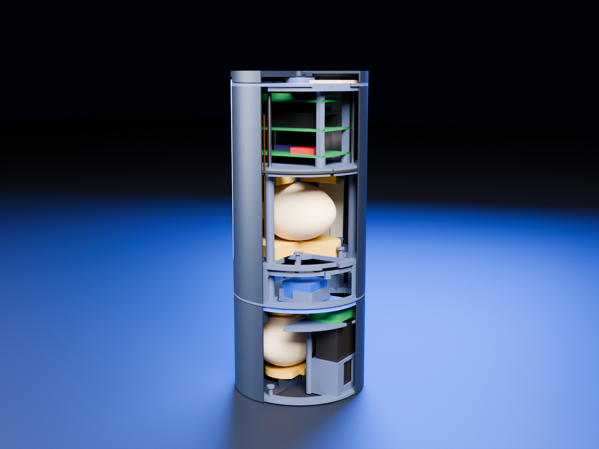

# CanSat Zénit completo · diseño en CAD (versión 1)

Diseño completo del CanSat, listo para imprimir en 3D: carga primaria con autogiro y
desacople, carga secundaria, protección de los dos huevos y soporte de la electrónica. Todo
está en un solo archivo de código (`cansat_completo.py`, CadQuery); cada medida se cambia
arriba, en la sección MEDIDAS, y se vuelve a generar.

## 1. Cumplimiento de la Guía de Misión

| Requisito de la guía | Diseño | Cumple |
|---|---|---|
| Cilindro de Ø 9–10 cm | Ø 96 mm | Sí |
| Alto total de 20 a 23 cm | 229 mm | Sí |
| Primaria ≤ 16 cm · secundaria ≤ 7 cm | 159 mm · 70 mm | Sí |
| Superficie lisa, sin protuberancias | Las aspas forman parte de la pared, al ras | Sí |
| Un solo orificio de Ø 9–10 mm y ≥ 3 mm de profundo en la tapa superior | Ø 9.5 × 3.5 mm | Sí |
| Autogiro embebido, pasivo, sin motor | 3 aspas sobre balero; las suelta un servo | Sí |
| Antenas por dentro | LoRa y GPS por dentro de la carcasa | Sí |
| ≤ 600 g con los 2 huevos de 65 g | ~600 g estimados (ver sección 5) | Justo: hay que pesar |

La revisión automática del archivo no encontró **ningún choque** entre piezas
(`salida/reporte.txt`).

## 2. Cómo funciona

**Carga primaria (de abajo hacia arriba)**

1. **Piso:** sostiene la pila de 9 V (acostada) y los 2 servos SG90. Al centro tiene la torre
   donde entra el poste de la secundaria.
2. **Desacople:** el poste de la secundaria entra al piso de la primaria. Un pasador de acero de
   3 mm atraviesa la torre y el poste. A 200 m, el servo de desacople jala el pasador y la
   secundaria cae por su peso.
3. **Anillo de retención:** detiene la punta de las 3 aspas. 0.4 s después del desacople, el
   servo del autogiro gira el anillo 12° y suelta las aspas.
4. **Huevo de la primaria:** acostado en una hamaca de ligas entre 6 ganchos abajo y 6 arriba,
   con una cama y un techo de espuma EVA.
5. **Electrónica:** las 3 placas de 4 × 6 cm (la Heltec en la placa 2) entre el disco base (con
   o-ring) y la tapa, con 4 arandelas de hule abajo y 4 arriba que absorben el golpe del
   aterrizaje. La antena LoRa baja pegada a la pared, al frente. Detalle en
   `Zenit_proteccion_electronica.pdf`.
6. **Tapa de la electrónica:** recibe el balero 688 y la antena GPS de 25 mm. Su ceja de Ø 96
   aprieta el tubo contra el piso.
7. **Rotor del autogiro:** tapa que gira sobre el balero, con el orificio para el dron y las
   bisagras de las 3 aspas.
8. **Columna:** 3 varillas roscadas M3 van del piso a la tapa. Por ahí pasa el peso cuando el
   dron lo carga. La carcasa es solo la piel.

**Autogiro.** Cada aspa mide 130 mm y es un pedazo curvo de la pared, al ras. Cuelga de una
bisagra en el rotor. Cerradas, las aspas tapan sus ranuras y la superficie queda lisa. Al
soltarlas, una liga en cada bisagra las empuja hacia afuera y el aire termina de abrirlas
(rotor de ~35 cm). El rotor gira sobre el balero; el cuerpo casi no gira, lo que ayuda al GPS y al IMU.

**Carga secundaria (cae libre, sin paracaídas, como pide la guía)**

- **Vaso:** fondo con costillas que se aplastan al impactar. Tiene 3 torres para atornillar la tapa.
- **Bandeja:** caja de la pila de 9 V parada, ganchos para la hamaca del huevo y media placa
  para el GPS NEO-6M.
- **Tapa:** el ESP32-C3 y el RFM95W van pegados por debajo, junto con los ganchos de arriba de la
  hamaca. Encima va el poste del desacople.

## 3. Piezas para imprimir (`salida/imprimir/`)

| Pieza | Cantidad | Tamaño (mm) | Cómo imprimir |
|---|---|---|---|
| carcasa_primaria | 1 | Ø 96 × 147 | Parada; 3 perímetros, sin relleno (es pared de 1.2 mm) |
| carcasa_secundaria | 1 | Ø 96 × 70 | Parada, con el fondo en la cama |
| aspa | 3 | 26 × 133 | Acostada con la cara curva hacia abajo; usar soporte solo en el nudillo |
| rotor | 1 | Ø 96 × 9 | Boca abajo (plato en la cama) |
| tapa_electronica | 1 | Ø 96 × 9 | Ceja en la cama |
| disco_electronica_base | 1 | Ø 93 × 17 | Acostado; ganchos hacia arriba |
| disco_huevo_base | 1 | Ø 93 × 11 | Acostado |
| piso_primaria | 1 | Ø 96 × 27 | Ceja en la cama |
| anillo_retencion | 1 | Ø 90 × 5 | Acostado |
| tapa_secundaria | 1 | Ø 93 × 24 | Poste hacia arriba |
| bandeja_secundaria | 1 | Ø 93 × 55 | Acostada |
| espaciador_base / espaciador_huevo | 3 + 3 | Ø 6 | Parados |
| separador_placas_0/1/2 | 4 + 4 + 4 | hexagonales | Parados (o usar los de nylon) |

PLA o PETG, capa de 0.2 mm, 3 perímetros, 15–20 % de relleno. Tiempo total aproximado:
12–14 horas. Los mismos archivos los imprime un servicio de impresión si no tienen impresora.

## 4. Lista de compras

| Cantidad | Pieza | Para qué |
|---|---|---|
| 1 | Balero 688ZZ (8 × 16 × 5 mm) | Giro del rotor |
| 1 m | Varilla roscada M3 (cortar 3 de ~150 mm) | Columna de la primaria |
| 20 | Tuercas M3 · 6 tornillos M3 × 10 | Columna, placas, tapa de la secundaria, rotor |
| 1 | Tornillo M3 × 12 con rondana | Detiene el rotor por abajo del balero |
| 10 cm | Varilla o clavo de acero de 3 mm | Pasador del desacople |
| 50 cm | Alambre de acero de 1 mm (cuerda de piano) | Varillas de los servos y ejes de las bisagras (1.5 mm) |
| 1 | O-ring 88 × 2 mm | Centra la electrónica en el tubo |
| 8 | Arandelas de hule o silicón Ø 8 × 3 × 2 mm | Amortiguan las 3 placas |
| 4 | Tuercas M3 con seguro de nylon | Para que las placas no se aflojen |
| 1 bolsa | Ligas chicas | Hamaca de los huevos y resorte de cada aspa |
| 1 hoja | Espuma EVA de 5 mm | Cama y techo de cada huevo |
| 2 | Pilas de 9 V (**de litio** si se puede: ~12 g menos cada una) | Energía |
| 3 | Placas perforadas 4 × 6 cm y separadores de nylon | Ya las tienen |

## 5. Peso estimado

| Grupo | Peso |
|---|---|
| Piezas impresas | 222 g |
| Huevos (2 × 65 g, como manda la guía) | 130 g |
| Pilas de 9 V alcalinas (2) | 92 g |
| Electrónica (Heltec, placas, sensores, GPS, secundaria) | 72 g |
| Servos, balero, varillas, tornillos, cables, hules, espuma y ligas | 84 g |
| **Total** | **~600 g** (límite 600 g) |

Queda **justo**. Para tener margen:
1. Pilas de 9 V de litio: −24 g.
2. Pesar cada pieza real en una báscula de cocina y anotarla. Mis números son estimados (±10 %).
3. Si aun así pasa, se puede adelgazar la tapa de la electrónica o acortar el vaso de la secundaria.

## 6. Velocidad del autogiro (8–12 m/s)

Después del desacople, la primaria pesa ~395 g. Con aspas de 130 mm el rotor mide ~35 cm de
diámetro, y la cuenta de un rotor en autorrotación (v = √(2·m·g / (ρ·C·A)), con C de 1.0 a 1.3) da:

| Largo del aspa | Ø del rotor | Velocidad estimada |
|---|---|---|
| 130 mm | 35 cm | 7.4–8.4 m/s (puede quedar **abajo** de 8) |
| 115 mm | 32 cm | 8.0–9.2 m/s |
| 100 mm | 29 cm | 8.9–10.2 m/s |

La recomendación es imprimir dos juegos de aspas (130 y 110 mm, cambiando `L_ASPA`) y elegir con
caídas de prueba. Si baja muy lento, se acortan las aspas; si baja muy rápido, se alargan.

## 7. Armado

1. **Piso:** meter las 3 tuercas en los hexágonos de abajo y atornillar las 3 varillas. Poner la
   pila con un cincho y los 2 servos en sus cunas. Montar el anillo de retención en sus guías y
   unir con alambre el brazo del servo del autogiro con el brazo del anillo.
2. Pasar los espaciadores de la base, el disco del huevo, la espuma y los espaciadores del huevo.
3. **Electrónica:** armar aparte las 3 placas con sus separadores entre el disco base y la tapa,
   con una arandela de hule en cada torre del disco y otra arriba de cada separador corto. Apretar
   sin aplastar el hule. Meterla en las varillas.
4. Deslizar la **carcasa** desde arriba hasta asentarla en el piso.
5. **Rotor:** el balero entra en la torre de la tapa. El perno del rotor entra en el balero y se
   fija por abajo con el tornillo M3 y la rondana.
6. **Aspas:** colocar cada una en su bisagra (eje de alambre de 1.5 mm), con una liga como
   resorte. Plegarlas en su ranura y trabar la lengüeta de la punta en el diente del anillo.
7. **Secundaria:** bandeja dentro del vaso. La tapa con la electrónica se atornilla a las 3 torres.

**El día del concurso** los huevos los dan los organizadores. Para meter el huevo de la
primaria se quitan las 3 tuercas de abajo del piso y se baja el piso. Practiquen esto: debe
salir en menos de 10 minutos.

## 8. El modelo en la página web

La estación terrena (portada «Prototipo» y panel) muestra **este mismo diseño**. Si cambian una
medida:

1. `python cansat_completo.py` (vuelve a generar las piezas).
2. `python exportar_web.py` (junta las piezas en `estacion-terrena/public/modelos/cansat.glb`).
3. Recargar la página. Los colores y los movimientos (aspas, separación) están en
   `estacion-terrena/public/cansat3d.js`.

## 9. Lo que falta comprobar con piezas reales

- Que el SG90 jale el pasador y gire el anillo sin atorarse (prueba P6, 20 de 20).
- Que las aspas abran solas con la liga (caídas de prueba).
- La velocidad de descenso con cada largo de aspa (sección 6).
- El huevo de la secundaria en caída libre: es la prueba más difícil. Probar con huevo real
  desde el techo (modo prueba) y luego con más altura.
- El peso real de todo armado.
