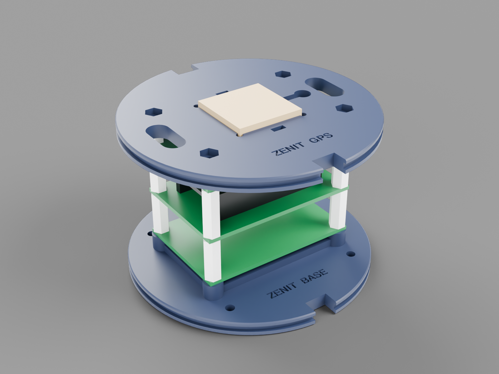

# Soporte de electrónica de la carga primaria

Bloque que sostiene las **3 placas perforadas de 4 × 6 cm** (con la Heltec V3 en la placa 2) y la
**antena GPS de 25 mm** arriba. Todo el bloque entra en el tubo de la carga primaria y se
amortigua como una sola pieza.



| Medida | Valor |
|---|---|
| Ø de los discos | 91 mm (para un tubo de Ø interior 92 mm: carcasa de Ø 96 con pared de 2 mm) |
| Altura total con la antena | 62.8 mm |
| Placas | 60 × 40 mm; agujeros a 55 × 35 mm entre centros |
| Altura de las placas (cara de abajo) | 11.0 · 28.6 · 48.2 mm desde la base |
| Alojamiento del GPS | 26 × 26 mm, 2.5 mm de profundo, con canal para el cable IPEX |

Ocupa ~63 de los 160 mm de la primaria. Los otros ~97 mm son para la pila, los 2 servos, el
huevo con su espuma y el autogiro.

## Archivos

| Archivo | Para qué |
|---|---|
| `soporte_electronica.py` | El diseño en código (CadQuery). Las medidas están arriba, en la sección MEDIDAS |
| `exportar_dxf.py` · `planos.py` · `render_vistas.py` | Generan los DXF, el PDF de planos y las imágenes (las imágenes usan Blender) |
| `salida/soporte_base.stl` · `.step` | Disco de abajo: imprimir |
| `salida/tapa_gps.stl` · `.step` | Disco de arriba con el alojamiento del GPS: imprimir |
| `salida/separador_*.stl` · `.step` | Separadores de 16, 18 y 6 mm (4 de cada uno), si no usan los de nylon |
| `salida/ensamble.step` | Todo armado, con placas y antena de muestra. Se abre en AutoCAD, Fusion, Inventor, SolidWorks u Onshape |
| `salida/*_planta.dxf` | Contorno y agujeros de cada disco, para AutoCAD o corte láser |
| `salida/planos_soporte_electronica.pdf` | Resumen, vista lateral con cotas y **plantillas a tamaño real** |
| `salida/imagenes/` | Vistas armada, explosiva y dentro del tubo |

## Antes de imprimir: medir 4 cosas

El diseño usa medidas típicas. Midan con vernier y, si algo cambia, corrijan el número en
`soporte_electronica.py` y vuelvan a generar (o pásenle las medidas a quien lo generó).

1. **Agujeros de las placas:** distancia entre centros (aquí 55 × 35 mm) y su diámetro (aquí para M3).
   Si sus placas traen agujeros de 2 mm, se cambia `TORNILLO = 2.0`.
2. **Altura de la Heltec** sobre su placa, con la pantalla (aquí 14 mm; el espacio es de 18 mm).
3. **Antena GPS:** lado (25.4 mm) y grosor total con su plaquita (aquí 4.5 mm).
4. **Ø interior del tubo** de la carcasa (aquí 92 mm).

Lo más rápido para comprobar: imprimir al 100 % la hoja 3 del PDF, poner encima las placas y
ver que los agujeros caigan en las cruces rojas.

## Impresión

- PLA o PETG (PETG aguanta mejor el sol y los golpes), capa de 0.2 mm, 3 perímetros, 40 % de
  relleno (giroide).
- Los dos discos se imprimen **acostados, con la cara grande abajo**. No necesitan soportes.
- Tiempo aproximado: 1.5 h la base, 1 h la tapa y 30 min los separadores.

## Armado

1. Meter las **4 tuercas M3** en los huecos hexagonales de abajo de la base (a presión o con
   una gota de pegamento).
2. Pasar las **4 varillas roscadas M3 de 60 mm** (o tornillos M3 × 60) y armar de abajo hacia
   arriba: placa 1 → separadores de 16 → placa 2 con la Heltec → separadores de 18 → placa 3
   (con el NEO-M8N) → separadores de 6 → tapa.
3. Poner las **4 tuercas de arriba** en los huecos hexagonales de la tapa (quedan al ras) y
   apretar parejo, sin pasarse.
4. Pegar la **antena GPS** en su alojamiento con cinta doble cara de espuma, mirando hacia arriba.
   Pasar el cable IPEX por el canal y el agujero hacia la placa 3. Si se quiere asegurar más,
   va un cincho por las dos ranuras.
5. Poner un **o-ring de 88 × 2 mm** en la ranura del canto de cada disco.
6. Atornillar la base al piso de la carga primaria con los **4 amortiguadores** (agujeros de afuera).

## Amortiguación: por qué o-rings y no ligas

- La idea de las ligas va bien encaminada, pero si el bloque cuelga de ligas, **se balancea**.
  El GY-91 (IMU) va en estas placas: si se balancea, mide mal la orientación y no detecta el
  jalón del desacople (el firmware espera un cambio de 0.6 g). El IMU debe ir **firme** en su placa.
- Por eso la amortiguación es de hule, pero corta y firme. Es lo mismo que usan los drones con
  su controladora:
  - **O-ring en cada disco:** es como una liga gruesa metida en una ranura. Centra el bloque en
    el tubo y absorbe los golpes de lado.
  - **4 amortiguadores de hule o silicón M3** entre la base y el piso: absorben el golpe de
    arriba hacia abajo al aterrizar.
- El huevo va aparte, en su espuma EVA. Él necesita protección más suave que la electrónica.

## Versión manual de prueba (tubo de PVC)

Para las pruebas rápidas, antes de imprimir la carcasa final:

1. Tubo de PVC con Ø interior cercano a 92 mm. Si el que consigan mide otra cosa, cambien
   `TUBO_DIAM_INT` y vuelvan a generar las plantillas.
2. Imprimir las plantillas 1:1 del PDF (hojas 3 y 4), pegarlas sobre MDF o acrílico de 5 mm,
   cortar con segueta o caladora y marcar los agujeros con un punzón.
3. En lugar de la ranura del o-ring, rodear el canto de cada disco con 2 vueltas de cinta de
   aislar o una tira de espuma, hasta que entre justo en el tubo.
4. Usar los separadores de nylon que ya tienen.

La versión de PVC sirve para probar electrónica, cables y caídas cortas. La versión impresa es la
que va al concurso: pesa menos y queda exacta.

## Cambiar medidas y volver a generar

```powershell
pip install cadquery ezdxf matplotlib
python soporte_electronica.py   # STEP y STL
python exportar_dxf.py          # DXF de planta
python planos.py                # PDF con cotas y plantillas 1:1
```

El STEP también se puede abrir en Fusion, Inventor u Onshape para seguir editándolo a mano.
